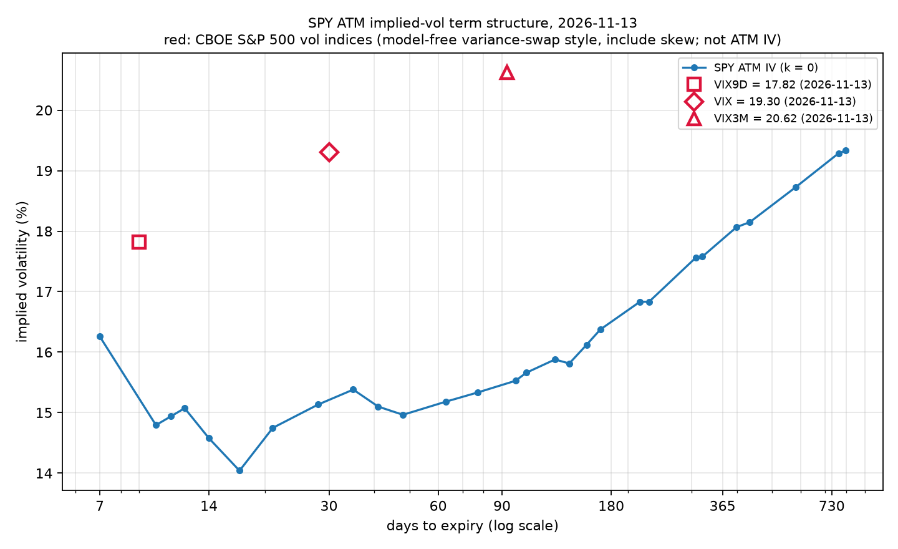
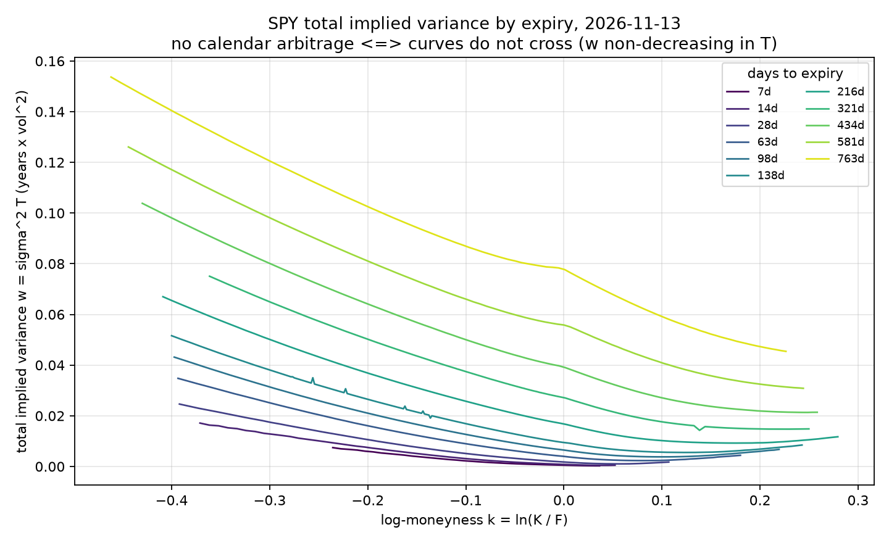
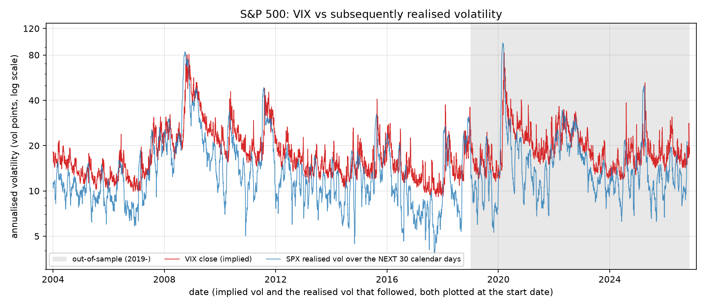
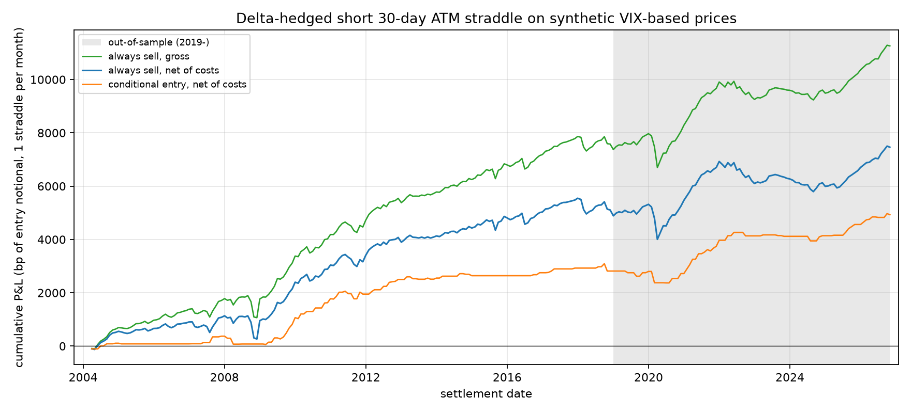
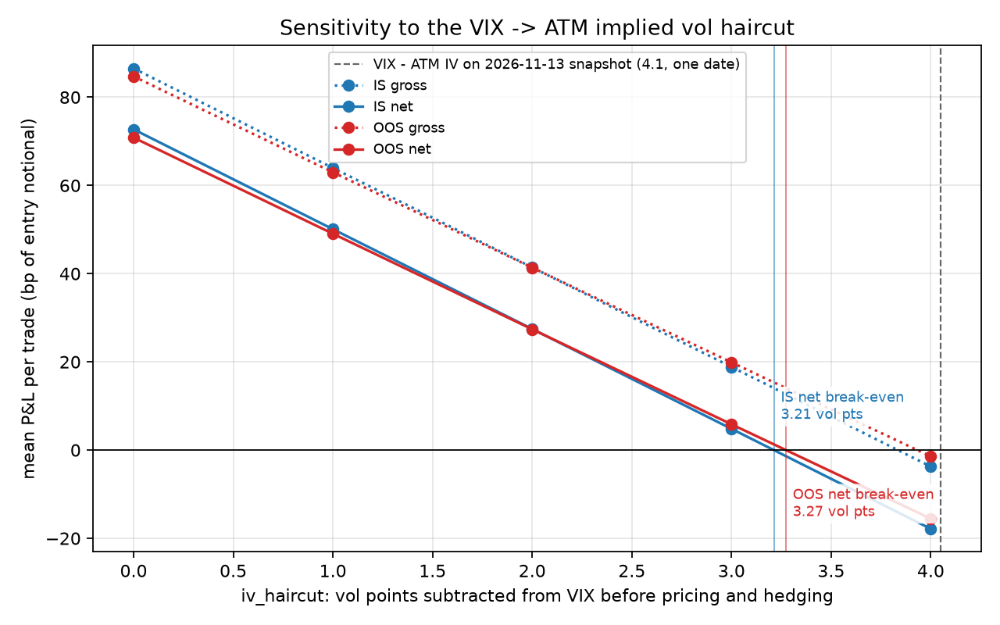

# volkit: option pricing, an SPY vol surface, and a test of the volatility risk premium

**Question.** Is S&P 500 implied volatility systematically higher than the volatility that follows, and would a delta-hedged short straddle have earned that gap after costs?

**Answer, as far as this data allows.** The first part holds in vol terms. Over 272 months (March 2004 to October 2026), VIX exceeded the realised S&P 500 vol of the next 30 calendar days by 3.66 vol points on average, and was higher in 83.5% of months (t = 7.56). The second part does not hold up statistically. Without historical option quotes, straddles are priced synthetically at VIX minus an assumed 2 vol-point haircut. On that basis, always selling made 27.4 bp of notional per month out of sample (2019 onwards) after assumed costs: t = 1.79, Sharpe 0.64, bootstrap 95% CI [-0.07, 1.69]. A conditional-entry variant looks better on paper, but its improvement over always-selling is within noise (section 5). The result also hinges on the haircut, which I cannot measure. Break-even is 3.21 (in-sample) to 3.27 (out-of-sample) vol points, and on the one date with quotes, VIX was about 4.1 vol points above 30-day ATM implied vol.

---

## 1. What is in the repo

```
volkit/
  pricing/black_scholes.py   closed-form BSM prices and analytic Greeks, with dividend yield q
  pricing/binomial.py        Cox-Ross-Rubinstein tree, European and American exercise
  pricing/monte_carlo.py     GBM Monte Carlo with antithetic variates and a standard error
  pricing/greeks.py          central finite-difference Greeks around any pricer
  iv/solver.py               implied vol: Newton with analytic vega, Brent fallback; American tree inversion
  iv/surface.py              parity forward, OTM quote selection, total-variance surface, arbitrage checks
  data/market.py             S&P 500, VIX family and 3m T-bill series, cached as CSV
  data/chain.py              option-chain snapshot download (yfinance), quote cleaning
  backtest/delta_hedge.py    exact self-financing P&L of a delta-hedged option book held to expiry
  backtest/costs.py          option half-spread and hedge-slippage assumptions
  backtest/metrics.py        realised vol, t-stat, Sharpe, bootstrap CI, drawdown
scripts/  download_data.py, build_surface.py, run_backtest.py
tests/    one pytest file per module plus cross-pricer agreement tests
data/raw/ cached inputs (SPX, VIX, VIX9D/VIX3M, DTB3, SPY and SPX chain snapshots)
results/  JSON/CSV outputs quoted below;  figures/  PNGs embedded below
```

Conventions (decimal rates and vols, `T` in years ACT/365) are in [CONVENTIONS.md](CONVENTIONS.md).

**Install and reproduce.** Developed with Python 3.14 (`pyproject.toml` allows 3.11+, untested). Dependencies: numpy, scipy, pandas, matplotlib, yfinance; pytest for development.

```bash
python -m venv .venv
.venv/bin/pip install -e ".[dev]"
.venv/bin/python -m pytest -q                 # 1494 passed
.venv/bin/python scripts/build_surface.py     # SPY surface -> results/surface_*, figures/*_spy.png
.venv/bin/python scripts/run_backtest.py      # Parts A and B -> results/backtest_*, frozen_params.json, figures
```

Both analysis scripts read only the cache in `data/raw/` and run offline. `scripts/download_data.py` refreshes it from Yahoo Finance, CBOE and FRED, which would change the numbers below.

## 2. Pricing library

Black-Scholes-Merton, a CRR tree (European and American) and Monte Carlo, with analytic and finite-difference Greeks. For S = K = 100, T = 1, r = 5%, sigma = 20%, q = 0:

| | Black-Scholes | CRR, 2000 steps | MC, 200k paths antithetic, seed 1 | American, CRR 2000 |
|---|---|---|---|---|
| Call | 10.450584 | 10.449584 | 10.4122 (s.e. 0.0232) | 10.449584 |
| Put | 5.573526 | 5.572526 | 5.5488 (s.e. 0.0148) | 6.089990 |

The MC estimates are 1.66 and 1.67 standard errors below Black-Scholes (same paths, so not independent). With q = 0 the American call equals the European one.

- **CRR error is about 2/steps, with a sign flip between even and odd steps.** Error × steps is -2.00 (even) and +1.75 (odd) from 100 to 2001 steps.
- **Antithetic variance reduction depends on moneyness.** At 200,000 paths, variance fell 8.7x for an ITM call (K = 80), 2.0x ATM and 1.2x OTM (K = 120), where most paths pay zero.
- **The finite-difference spot bump is vol-scaled, h = 0.2 · sigma · sqrt(T) · S.** A 1% bump is smaller than the tree's node spacing (1.8% in log price at 500 steps), so the second difference mostly measures whether a node crossed the strike: true gamma is 0.01876, a 1% bump gave 0.0335 (500 steps) and 0.0071 (501), the vol-scaled bump 0.0194 and 0.0185.

| Same call | delta | gamma | vega | theta (per year) | rho |
|---|---|---|---|---|---|
| Analytic BSM | 0.63683 | 0.01876 | 37.524 | -6.414 | 53.232 |
| FD on BSM (default bumps) | 0.63546 | 0.01873 | 37.524 | -6.414 | 53.232 |
| FD on CRR, 2000 steps | 0.63546 | 0.01895 | 37.519 | -6.414 | 53.232 |

The delta gap is truncation error from the large default bump; a 0.01% bump recovers 0.63683.

## 3. Implied volatility and the SPY surface

**Solver.** Newton-Raphson with analytic vega inside a shrinking bracket, falling back to Brent if a step leaves the bracket, vega is tiny or it fails to converge. Prices outside no-arbitrage bounds return `nan`.

**Data.** A SPY chain from Yahoo Finance, downloaded on Sunday 2026-11-15, so the quotes are the Friday 2026-11-13 close; `T` is measured from Friday 16:00 New York (measuring from the download time would raise the 10-day ATM IV from 14.79% to 15.98%). The SPX chain downloaded at the same time was unusable: only 5% of its 20,894 rows had a bid, and one expiry survived cleaning, so no SPX surface was built.

**Method.**

1. **Forward** from put-call parity, C - P = DF (F - K), with DF = exp(-rT) from the 3-month T-bill (4.22%, one flat rate). Regressing C - P on K would also give DF, but early exercise biases it: its implied rates run from -35% to +24%, and on a synthetic American chain with a true rate of 4.22% it gave -11.9% at 14 days.
2. **IVs** from out-of-the-money mids only (puts below F, calls at or above F), inverted with Black-Scholes. Re-inverting 120 quotes with an American tree, the mean gap per moneyness bucket was at most 0.15 vol points up to 126 days. It grows with maturity and peaks for near-ATM long-dated puts: 2.37 vol points for a December 2028 put (19.39% vs 17.02%), stable to under 0.01 vol points between 200 and 800 tree steps.
3. **Interpolation** in total variance w = sigma² T against k = ln(K/F), linear in k and in T. This adds no calendar arbitrage of its own. No smoothing or parametric fit.
4. **Outliers.** An isolated-quote rule removed 24 quotes, 23 in the March, June and September 2027 quarter-end expiries.

| Cleaning step (first filter failed) | Rows |
|---|---|
| Raw snapshot | 10,354 |
| bid < $0.05 | -1,167 |
| crossed (bid > ask) | -6 |
| relative spread > 25% | -217 |
| fewer than 7 days to expiry | -711 |
| ln(K/S) outside (-0.40, 0.30) | -1,515 |
| **Clean rows** | **6,738** |
| OTM quotes in the surface, after outlier rule | 3,661 in 28 expiries |

**Results** (`results/surface_summary.json`):

- 30-day ATM IV 15.22% vs VIX 19.30%, a 4.08-point gap. Expected: VIX is a variance-swap-style index over all strikes and includes the skew.
- 30-day 25-delta risk reversal 5.99 vol points (put 18.81%, call 12.82%).
- ATM term structure: 15.19% (9d), 15.22% (30d), 15.49% (93d), 17.88% (365d).
- Calendar violations: 0 of 1,107 grid points.
- Butterfly (convexity) violations: 613 of 3,605 strike triples at $0 tolerance, of which 552 are a cent or less and 426 are in expiries of 105 days or less. At 1 cent, 61 remain; 45 of those are in the three quarter-end expiries and January 2029 (largest deficit $4.98).
- Yahoo's IV column differs from mine by a median absolute 1.01 vol points.


*Smiles for five expiries, 7 to 763 days (line = mid IV, band = bid-ask IV); the short expiries are much steeper in k.*


*ATM IV by expiry; VIX9D, VIX and VIX3M sit 2.6, 4.1 and 5.1 vol points above ATM IV at their maturities.*


*Total variance by expiry; curves do not cross. The small kinks visible in two curves are in quarter-end expiries (138 and 321 days).*

## 4. Backtest

**Part A** uses no trading assumptions: VIX at each month's first close vs zero-mean realised S&P 500 vol over the next 30 calendar days.

| Period | n | Mean IV − RV (vol pts) | Median | % IV > RV | t | 95% CI of mean |
|---|---|---|---|---|---|---|
| All 2004-03 to 2026-10 | 272 | 3.66 | 4.36 | 83.5% | 7.56 | [2.69, 4.54] |
| 2004-2007 | 46 | 3.00 | 3.99 | 76.1% | 7.21 | [2.17, 3.81] |
| 2008-2009 | 24 | 2.35 | 5.89 | 75.0% | 0.76 | [-4.00, 7.86] |
| 2010-2014 | 60 | 4.90 | 5.21 | 91.7% | 6.32 | [3.31, 6.32] |
| 2015-2019 | 60 | 3.17 | 4.57 | 83.3% | 4.32 | [1.67, 4.54] |
| 2020-2022 | 36 | 3.89 | 4.32 | 77.8% | 1.78 | [-0.83, 7.55] |
| 2023-2026 | 46 | 3.87 | 3.97 | 89.1% | 4.75 | [2.13, 5.26] |
| In-sample 2004-2018 | 178 | 3.48 | 4.38 | 82.6% | 6.28 | [2.36, 4.55] |
| Out-of-sample 2019- | 94 | 4.01 | 4.34 | 85.1% | 4.30 | [2.01, 5.67] |

In variance units (what a variance swap pays) the evidence is much weaker: VIX² − RV² has t = 1.86 overall and 0.89 out of sample, largely because a few crash months are very negative.


*VIX and the following 30-day realised vol, both at the start date; shading = out-of-sample. The worst months were March 2020, autumn 2008, April 2025 and August 2011.*

**Part B design.** At each month's first close, sell one straddle struck at the forward, K = S₀ exp((r − q)T), expiring on the trading day nearest entry + 30 days (capped at the next entry, so no overlap). Options are priced by Black-Scholes at VIX − haircut, delta-hedged at the close every 2 days at that day's VIX − haircut, and cash settled. Assumptions, not measurements: haircut 2 vol points; option half-spread 0.5 vol points × vega, paid at entry; hedge cost 1 bp of notional traded; q = 1.8%. P&L is in bp of entry spot, and `delta_hedge.py` decomposes it exactly into premium, payoff, hedge P&L, dividends, financing and costs.

**Protocol.** Everything was chosen on in-sample entries (2004-03 to 2018-12). Haircut, costs, hedge vol and q were fixed a priori. Tuned on in-sample net Sharpe: hedge frequency from {1, 2, 5} days (2 won: 0.73 vs 0.51 and 0.30), and an optional entry filter (sell only if VIX minus trailing 21-day RV exceeds a threshold) from seven thresholds 0 to 0.06 (0.05 won). These go into [`results/frozen_params.json`](results/frozen_params.json); the out-of-sample step reads only that file and runs the 2019+ trades once. OOS sensitivities are reported, never used to choose. Re-running both scripts from the cache in a copy of the repo gave identical results apart from the frozen file's timestamp.

**Part B results** (bp of notional per trade; Sharpe annualised with sqrt(12); bootstrap CIs):

| Variant | n | Mean (bp) | t | Sharpe [95% CI] | Worst trade (bp, entry) | Max DD (bp) |
|---|---|---|---|---|---|---|
| IS always-sell, gross | 178 | 41.4 | 4.23 | 1.10 [0.55, 1.78] | -574 (2008-10-01) | 828 |
| IS always-sell, net | 178 | 27.5 | 2.80 | 0.73 [0.21, 1.35] | -587 (2008-10-01) | 869 |
| IS conditional, gross | 62 | 59.3 | 4.51 | 1.98 [1.01, 3.24] | -263 (2018-10-01) | 271 |
| IS conditional, net | 62 | 45.4 | 3.44 | 1.52 [0.59, 2.67] | -277 (2018-10-01) | 312 |
| **OOS always-sell, gross** | 94 | 41.4 | 2.71 | 0.97 [0.20, 2.13] | -778 (2020-03-02) | 1,272 |
| **OOS always-sell, net** | 94 | **27.4** | **1.79** | **0.64 [-0.07, 1.69]** | -791 (2020-03-02) | 1,315 |
| OOS conditional, gross | 40 | 66.8 | 3.41 | 1.87 [0.60, 4.06] | -410 (2020-02-03) | 410 |
| OOS conditional, net | 40 | 52.8 | 2.69 | 1.47 [0.29, 3.47] | -425 (2020-02-03) | 446 |

The conditional Sharpes annualise with sqrt(12) although the rule trades in only 40 of 94 OOS months, which flatters them. Counting skipped months as zero, its OOS net Sharpe is 0.92 vs 0.64 for always-sell, and it earns 22.5 bp per month vs 27.4. Costs average 11.3 bp per trade (option spread) plus 2.6 bp (hedging).

**Sensitivities** (net mean bp per trade, Sharpe in brackets; one input moved from the frozen setting):

| Change | In-sample | Out-of-sample |
|---|---|---|
| haircut 0 / 1 / **2** / 3 / 4 vol pts | 72.7 / 50.1 / **27.5** / 4.8 / -17.9 | 70.8 / 49.0 / **27.4** / 5.8 / -15.5 |
| break-even haircut, net (gross) | 3.21 (3.83) | 3.27 (3.93) |
| costs zero / **base** / double | 41.4 / **27.5** / 13.5 (1.10 / 0.73 / 0.36) | 41.4 / **27.4** / 13.4 (0.97 / 0.64 / 0.31) |
| hedge every 1 / **2** / 5 days | 18.7 / **27.5** / 15.0 (0.51 / 0.73 / 0.30) | 24.0 / **27.4** / 33.4 (0.57 / 0.64 / 0.65) |
| hedge vol **current** / entry | **27.5** / 23.8 | **27.4** / 23.7 |
| q 0 / **1.8%** / 3% | 29.1 / **27.5** / 26.0 | 28.9 / **27.4** / 26.3 |

Each vol point of haircut moves the mean by about 22 bp per trade, against a net mean of 27 bp. Costs matter next; q and hedge vol barely matter.

**Attribution.** Gross P&L per unit of entry vega correlates 0.79 (IS) and 0.85 (OOS) with pricing vol minus realised vol over the trade, with slope 0.62 in both. The P&L mostly tracks implied minus realised; the slope below 1 is consistent with path dependence and discrete hedging, which I have not separated.


*Cumulative P&L, one straddle per month: gross, net, and the conditional rule (net). The 2008 and 2020 drawdowns show in all three.*


*Mean P&L per trade vs haircut; net break-even 3.21 (IS) and 3.27 (OOS). Dashed: the 4.1-point VIX − ATM gap on the one snapshot date.*


*Per-trade gross P&L (vol points) vs pricing vol minus realised vol; the far bottom-left points are October 2008 (IS) and March 2020 (OOS).*

## 5. What did not work

- **No SPX surface** from the weekend snapshot (bids on 5% of rows).
- **Residual butterfly arbitrage.** 61 violations at 1 cent, mostly in quarter-end and January 2029 expiries; counted, not repaired.
- **Early-exercise bias measured, not corrected.** The long-dated SPY put wing is inverted as European, overstating IV by up to 2.37 vol points at 2 years.
- **Short-dated implied dividend yields are meaningless.** Parity q at 7 days is 12.7%. Forward × DF for expiries up to 30 days implies a spot near 752.4 vs the reported 754.37, a 0.26% timing mismatch between spot and option closes that a small T blows up.
- **The conditional rule's improvement is within noise.** The in-sample grid is flat (Sharpe 0.72 to 0.85 for thresholds 0 to 0.05). The OOS months it skipped averaged +8.5 bp (t = 0.39, computed from `backtest_trades.csv`). Its edge comes mostly from skipping March 2020 (-791 bp), while it traded February 2020 (-425 bp); dropping March 2020 post hoc, always-sell has the higher OOS Sharpe (1.03 vs 0.93).
- **The in-sample hedge frequency was not best out of sample.** 2 days won in-sample (paired t vs daily only 1.72); out of sample 5 days was slightly better (Sharpe 0.65 vs 0.64, mean 33.4 vs 27.4 bp).
- **One bug found after seeing OOS results.** The first in-sample trade had no entry signal (fewer than 21 prior returns). The in-sample period now starts in March 2004 and a missing signal raises an error. OOS results were unchanged and no parameter was retuned, but the fix came after the OOS run.

## 6. Limitations

- Synthetic option prices. VIX is not ATM IV; the gap is unknown historically and likely time-varying, and my one observation (about 4.1 points) is above break-even. VIX also has constant 30-day maturity while the option ages.
- Costs are assumed. Hedging is close-only; no intraday hedging, margin or capital limits; P&L is per straddle.
- Small samples: 178 IS and 94 OOS trades.
- Constant q = 1.8%; one flat T-bill rate for all maturities.
- Mild data snooping: 3 hedge frequencies × 7 thresholds tried in-sample.
- Yahoo data is noisy (only 43% of contracts traded in the last 30 minutes had a last inside the bid-ask); the surface is one snapshot with no SVI fit.

## 7. What I would do next with real data

- Historical SPX quotes (OptionMetrics or CBOE end-of-day) to replace synthetic pricing and measure the VIX − ATM gap month by month.
- An SPX surface from a market-hours snapshot, where European exercise makes parity exact and removes the early-exercise bias.
- Per-expiry SVI fits with no-butterfly and no-calendar constraints.
- SPY forwards and dividends estimated consistently with American exercise, jointly with the tree inversion.
